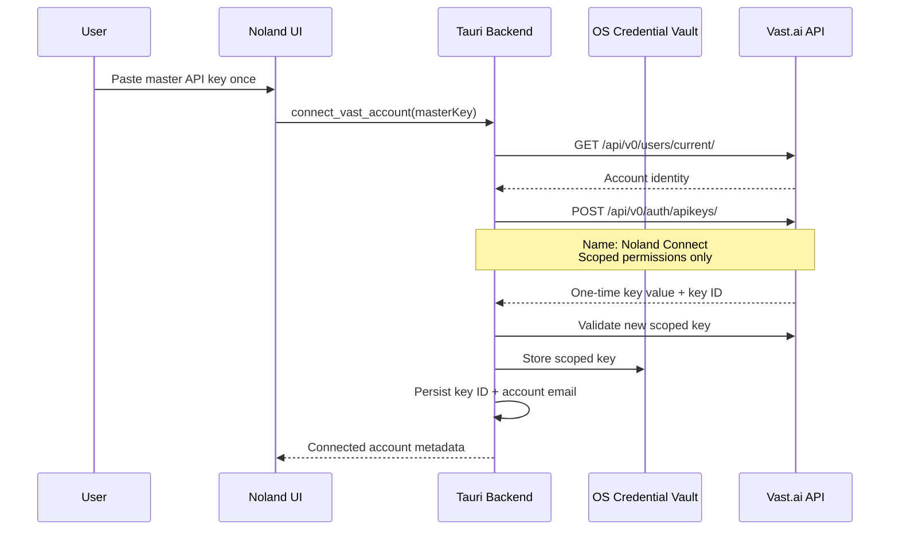

# Vast.ai Account Connection

Noland Connect provides an OAuth-like account connection experience on top of Vast.ai API keys.

Vast.ai does not currently expose a third-party OAuth authorization-code flow. Its documented REST API authenticates every request with a Bearer API key. Noland therefore exchanges a one-time user-provided key for a named, scoped application key.

## Connection flow



The master key is not persisted. The generated scoped key is held only in Tauri backend memory while the app runs and stored in the operating-system credential vault for future launches. It is removed from app-state responses before they cross the Tauri IPC boundary, so frontend JavaScript receives only connection metadata and a credential-availability flag. `state.json` stores the Vast account email and generated key ID; the managed secret and runtime availability flag are explicitly reset before JSON serialization.

## Scoped permissions

The generated key receives:

- `misc`: search marketplace offers;
- `user_read`: read user/account and SSH-key information;
- `user_write`: upload the Noland SSH key and revoke/replace the managed API key;
- `instance_read`: list and inspect rented instances;
- `instance_write`: create, stop, reboot, and destroy instances.

It does not receive billing, machine-hosting, or team-management categories.

Vast permission categories are coarse. In particular, `user_write` covers more than SSH-key upload, but it is required for Noland's current provisioning flow.

## Reconnect and rollback

When reconnecting:

1. Noland validates the supplied master key.
2. It creates and validates a replacement scoped key.
3. It stores the replacement in the OS vault.
4. It persists the new key ID/account metadata.
5. It attempts to revoke the previous Noland key.

If validation, vault storage, or local-state persistence fails, Noland attempts to revoke the newly created key and restore the previous local credential.

## Disconnect

`disconnect_vast_account` revokes the managed key through:

```text
DELETE /api/v0/auth/apikeys/{id}/
```

After successful remote revocation, it deletes the key from the OS credential vault and clears the local account metadata. A manually configured advanced key has no recorded remote key ID, so disconnect removes it locally but cannot identify/revoke it remotely.

## Referral link

New-user signup links use:

```text
https://cloud.vast.ai/?ref_id=472612
```

The referral link is shown for account creation and onboarding. Existing users can use the normal login/key-management paths. Vast.ai states that referral attribution applies to new accounts created through the referral link.

## Security properties

- Master key used only during the exchange request.
- Managed key response bodies are redacted from Vast API logs.
- Managed key is not persisted in `state.json` or exposed through frontend app-state responses.
- A missing vault entry is surfaced as “Needs reconnect” while retaining the key ID for audit and manual revocation.
- OS vault storage uses Keychain on macOS, Credential Manager on Windows, and the platform keyring/secret service on Linux.
- Disconnect revokes remotely before clearing the local credential.
- API-key creation is not repeated during normal startup or API calls.
